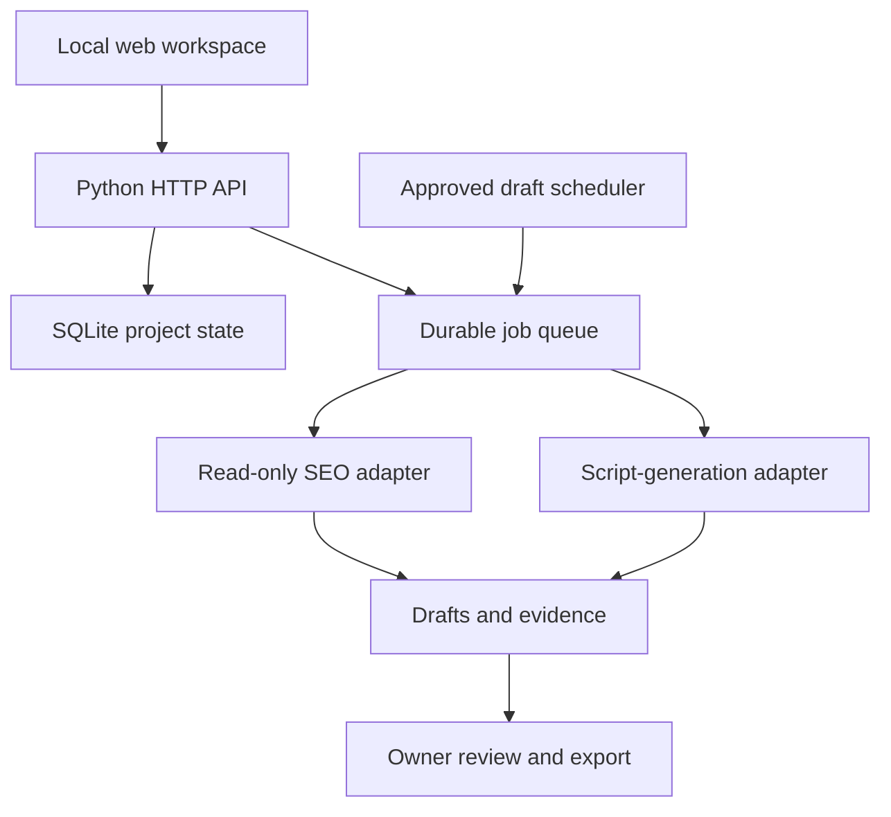

# GoalPilot

**Turn an outcome into a plan, a bounded task, and a reviewable result.**

GoalPilot is an early, local-first personal execution workbench. Describe a goal, answer the missing questions, edit its plan, run a task and review the saved output. The source is public; your projects, drafts, credentials and analytics are not.

## Run it

Python 3.12 or newer. No pip or npm dependencies are required for v0.1.

```bash
python -m goalpilot
```

Open **http://127.0.0.1:8000**. Create a goal, save its intake details and choose **Try offline demo**. Demo runs make no network requests and are clearly labelled synthetic.

```bash
python -m unittest discover -s tests -v
python -m compileall -q goalpilot
```

## What works today

| Capability | v0.1 behavior |
|---|---|
| Goal intake | Detects SEO/video intent with simple rules; asks missing questions; supports a custom manual brief |
| Planning | Editable checklist from workflow templates, not an autonomous general-purpose planner |
| SEO · Phase 1A | Nested sitemap discovery, up to ten initial-HTML pages, 40 internal-link checks, canonical/redirect checks, structural JSON-LD validation, duplicate metadata, Markdown + JSON evidence |
| Video script package | Original scripts from supplied source notes via an explicitly configured OpenAI-compatible model; offline template available |
| Reference content | Accepts a pasted transcript or shot notes as context; does **not** fetch or watch videos |
| Review | Immutable Markdown drafts, exports and content-hash-bound owner review; review does not publish |
| Scheduling | Explicitly approved recurring draft generation; max seven runs / seven days; invalidates on input changes; no paid-model schedules |
| Persistence | SQLite projects, queued runs, drafts, schedules and activity history |
| Safety | Public-IP-pinned HTTPS crawler, robots policy, bounded responses, PAUSE, origin/Host checks, optional local access token |

**Not implemented:** automated web/SERP research, keyword volumes, GSC/GA4, website modification/PRs, audiovisual analysis, rendering, TTS, social uploads, arbitrary tool execution, multi-user accounts or public hosting. Missing integrations are shown as planned, not simulated successes. No search ranking or revenue result is guaranteed.

## Optional PageSpeed measurement

Set `PAGESPEED_API_KEY` in the server environment with PageSpeed Insights API enabled. In an SEO project, select **Yes — send the website URL to Google PageSpeed**, save the details, then run the live task. This explicitly permits sending that public URL to Google. The choice is saved in the run snapshot and any subsequently approved draft schedule. No key is sent to the browser.

At most two requests are made (mobile/desktop) for the entered URL. Scores, LCP, CLS and TBT are Lighthouse **lab** measurements, not field INP. Missing credentials, null scores, runtime errors or quota failures are reported as unmeasured. Offline demos make no API calls even if a key exists. Never commit actual audit exports or API keys to this public repository.

See [Phase 1A scope and limits](docs/seo-phase-1a.md). Analytics and keyword research remain future milestones.

## Optional model configuration

Choose a compatible provider and model. Configure these in your shell or process manager; the app does **not** automatically load `.env` files:

```bash
export LLM_BASE_URL=https://api.openai.com/v1
export LLM_MODEL=YOUR_COMPATIBLE_MODEL
# Set LLM_API_KEY using your secret manager or local environment, never in source control.
python -m goalpilot
```

A live video run requires all three variables, including `LLM_API_KEY`, plus a checked consent box for sending the saved source notes to that provider and incurring its fees. One request, no automatic retries, maximum 1,600 completion tokens. Your provider/model must support the Chat Completions `max_completion_tokens` field. The app does not impose a currency budget; configure provider-side spend limits. No paid API calls were required to test the app.

Model output is an unverified draft; review its claims and rights to all assets. Reference notes guide original structure and pacing, not copying another creator's script. Web pages and model output are data, never authority to execute commands or publish.

## Local security and operations

The service binds to **127.0.0.1 only**. Do not expose it through a tunnel or reverse proxy: production auth/TLS and user isolation are not implemented. Optionally set `GOALPILOT_TOKEN` and enter that token in the local UI; it stays in session storage. Model keys never go to the browser. `runtime/` is git-ignored; use OS access controls and encrypted backups if storing sensitive projects.

`touch PAUSE` stops new work and running workflows at their next check boundary. An in-flight network request may finish; partial drafts are not saved after a pause. Schedule disabling remains possible. Remove PAUSE to resume. The worker runs while the app is open; it is not an OS cron daemon. Restarted in-flight jobs are marked interrupted and never automatically retried because a provider may already have charged.

Scheduling only creates drafts. It does not publish to a website or a channel. A plan edit invalidates schedule consent; manual queued runs retain the exact inputs approved when queued. Use `--no-worker` for API-only testing.

## Architecture



The initial stack is Python standard library + plain HTML/CSS/JavaScript, keeping startup simple for a personal tool. Workflow and provider boundaries are isolated so the UI, database and worker can be replaced later without mixing business-specific data into source code.

See [architecture](docs/architecture.md), [API](docs/api.md) and [roadmap](docs/roadmap.md). Released under the [MIT license](LICENSE).
